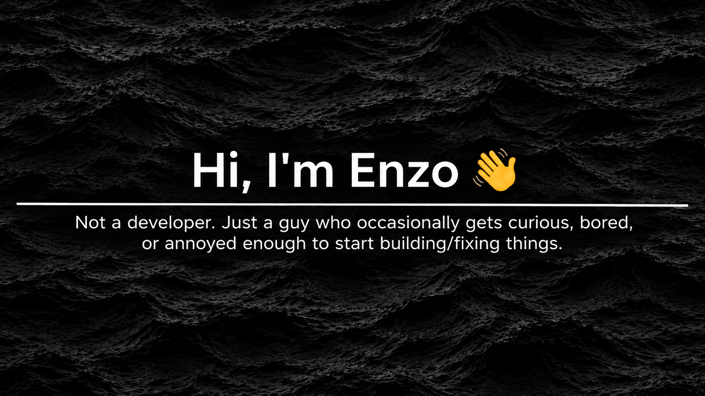

### About me 

- No formal expertise, just curiosity and questionable amounts of free time (or poor time management and unhealthy sleep schedules).
- I build random stuff because I want to see if I can.
- Sometimes it's a fun idea. Sometimes it's boredom. Sometimes something annoys me enough that I decide to fix it myself.
- Usually figuring things out as I go. Occasionally even succeeding.

### Things I've messed around with 

- **Feedr** — An RSS feed reader, because apparently reading the news wasn't complicated enough.
- **ESP32 & Electronics** — Finding new ways to make simple things unnecessarily complicated.
- **Linux Ricing** — Wanted to add my cats as virtual pets. Did it. Turns out they're just as lazy as the real ones.
- **Small tools & scripts** — Automating things that probably would've taken less time to do manually, or things I probably shouldn't have tampered with in the first place but somehow survived (Yep, looking at you ).

---

*No grand plans. Just curiosity, mild frustration, and questionable decisions.*
